# 游戏实机截图文档 (Gameplay Screenshots)

本文档专门用于归档《飞跃极速》各个开发阶段的实机运行截图与渲染效果，便于在 GitHub 上直接查阅与审查。

## 阶段 3.2 · 氮气加速系统实机运行 (Phase 3.2)

### 1. 阶段 3.2 氮气就绪待命状态 (Nitro Ready - 100% 满能量)
* **文件路径**：`docs/screenshots/stage3_2_nitro_ready.png`
* **GitHub 直链**：[查看图片](https://raw.githubusercontent.com/liucai18/fyjs/main/docs/screenshots/stage3_2_nitro_ready.png)
* **核心内容**：赛博风格底部氮气仪表槽居中展示，100% 满能量青蓝发光能量条，状态指示为 `⚡ NITRO READY [SHIFT]`。赛车以基础巡航极速 185 km/h 平稳推进，双喷口等离子尾焰常态运作。

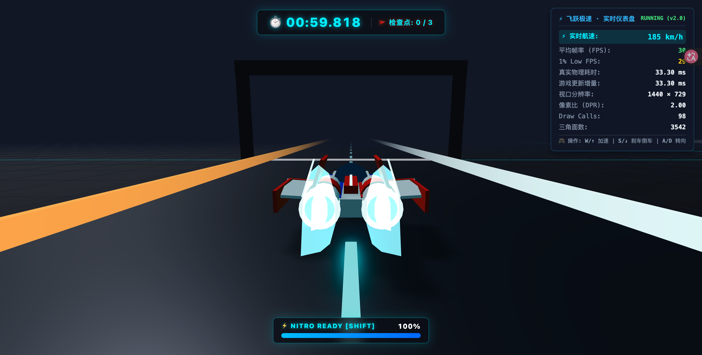

### 2. 阶段 3.2 氮气极速爆发激活中 (Nitro Active - 时速突破 220+ km/h)
* **文件路径**：`docs/screenshots/stage3_2_nitro_active.png`
* **GitHub 直链**：[查看图片](https://raw.githubusercontent.com/liucai18/fyjs/main/docs/screenshots/stage3_2_nitro_active.png)
* **核心内容**：按住 Shift 键瞬间激活高能氮气喷射，仪表槽切换至燃爆烈焰橙红脉冲特效与 `🔥 NITRO ACTIVE!` 提示，能量按 25%/s 持续消耗（当前 75%）。推进力获得 1.85x 强力增益，极速上限提升至 270 km/h（实机抓拍 248 km/h），等离子尾焰拉长至 1.5 倍爆发态，FOV 景深自适应拉伸。

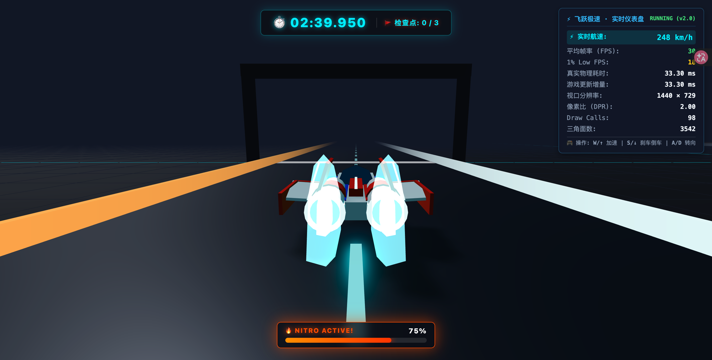

### 3. 阶段 3.2 氮气能量耗尽强制断气警告 (Nitro Depleted - 0% 空槽告警)
* **文件路径**：`docs/screenshots/stage3_2_nitro_depleted.png`
* **GitHub 直链**：[查看图片](https://raw.githubusercontent.com/liucai18/fyjs/main/docs/screenshots/stage3_2_nitro_depleted.png)
* **核心内容**：当氮气能量持续消耗至 0% 时，底层系统毫秒级强制切断超额推进力与速度增益，仪表盘自动触发高危红色边框与警示文字 `⚠️ NITRO DEPLETED (0%)`。赛车动力平滑受控回落至基础极速区间（216 km/h），杜绝速度骤停顿挫感与数值抖动。

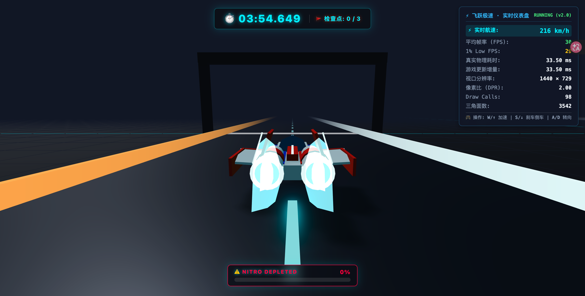

### 4. 阶段 3.2 松开 Shift 自动平滑充能中 (Nitro Recharging - 10%/s 恢复)
* **文件路径**：`docs/screenshots/stage3_2_nitro_recharging.png`
* **GitHub 直链**：[查看图片](https://raw.githubusercontent.com/liucai18/fyjs/main/docs/screenshots/stage3_2_nitro_recharging.png)
* **核心内容**：松开 Shift 加速键后，氮气能量系统自动启动线性回充机制（速率 10%/s，从空到满约 10 秒）。状态显示 `⚡ RECHARGING... [SHIFT]`，青蓝能量槽平滑回涨（当前 48%），赛车以 195 km/h 巡航。倒计时、暂停或完赛状态下能量自动绝对冻结。

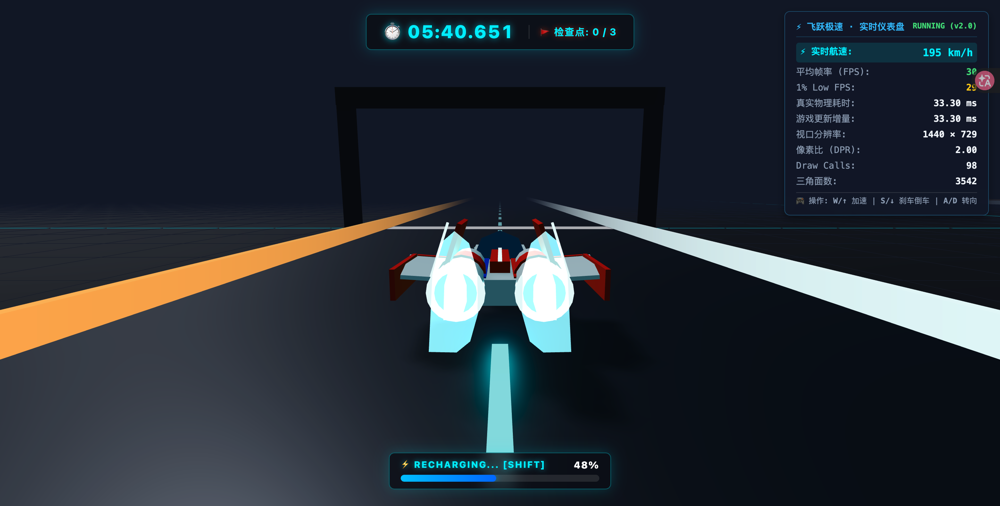

---

## 阶段 3.1 · 核心竞速闭环实机运行 (Phase 3.1)

### 1. 阶段 3.1 起跑 3-2-1-GO 倒计时与油门防抢跑锁定 (Countdown)
* **文件路径**：`docs/screenshots/stage3_1_countdown.png`
* **GitHub 直链**：[查看图片](https://raw.githubusercontent.com/liucai18/fyjs/main/docs/screenshots/stage3_1_countdown.png)
* **核心内容**：赛博霓虹居中超大倒计时动画（3-2-1-GO）、顶部计时器与检查点状态栏（00:00.000 / 0/3 CP）、倒计时阶段赛车油门硬锁定严禁抢跑。

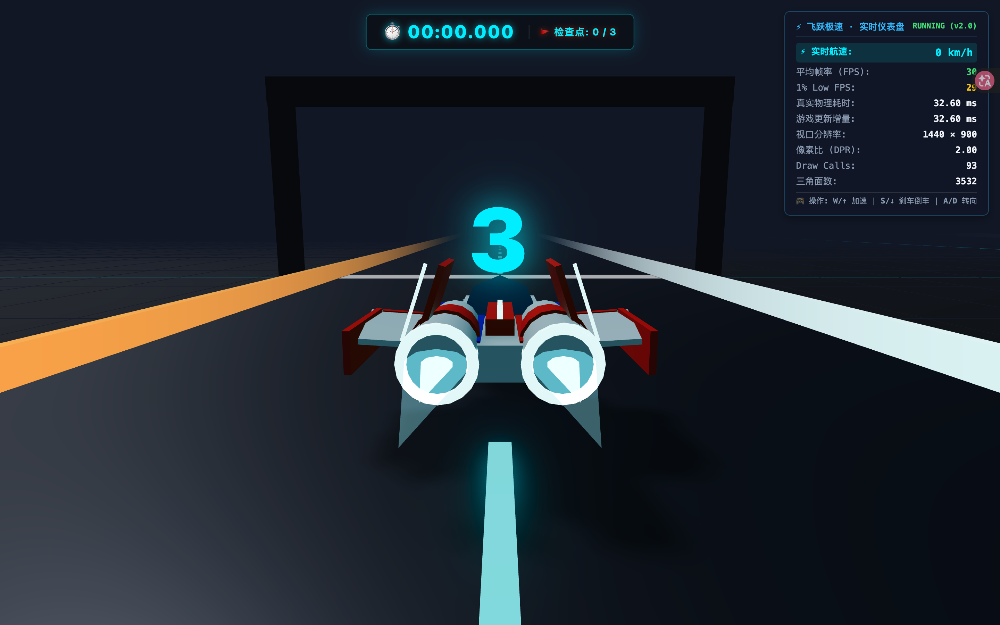

### 2. 阶段 3.1 倒计时发车 GO! 阶段与计时同步启动 (GO Phase)
* **文件路径**：`docs/screenshots/stage3_1_go.png`
* **GitHub 直链**：[查看图片](https://raw.githubusercontent.com/liucai18/fyjs/main/docs/screenshots/stage3_1_go.png)
* **核心内容**：发车信号 GO! 独立展示窗口（持续 500ms），翠绿高亮霓虹文字与呼吸缩放动效，发车瞬间控制解锁并精确同步正式计时起点。

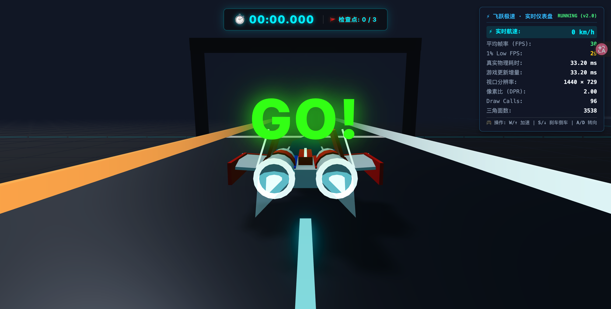

### 3. 阶段 3.1 正常驾驶竞速计时与检查点收集 (Racing HUD)
* **文件路径**：`docs/screenshots/stage3_1_racing_hud.png`
* **GitHub 直链**：[查看图片](https://raw.githubusercontent.com/liucai18/fyjs/main/docs/screenshots/stage3_1_racing_hud.png)
* **核心内容**：单圈高精度毫秒计时器实时累加（14.285s）、赛道关键检查点激活指示（1/3 CP）、167 km/h 高速推进。

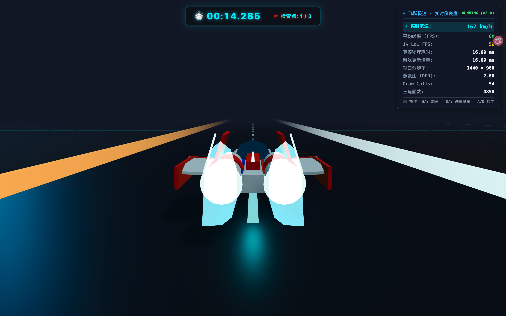

### 4. 阶段 3.1 终点冲线结算面板展示 (Race Finished)
* **文件路径**：`docs/screenshots/stage3_1_race_finished.png`
* **GitHub 直链**：[查看图片](https://raw.githubusercontent.com/liucai18/fyjs/main/docs/screenshots/stage3_1_race_finished.png)
* **核心内容**：前后两帧连续扫掠穿线检测（Continuous Swept-Segment Crossing）触发冲线判定、3/3 检查点全量门禁校验通过、完赛结算弹窗展示最终圈速（00:43.682）、极速（196 km/h）与一键重试引导。完赛后动力学完全锁死，杜绝继续开动。

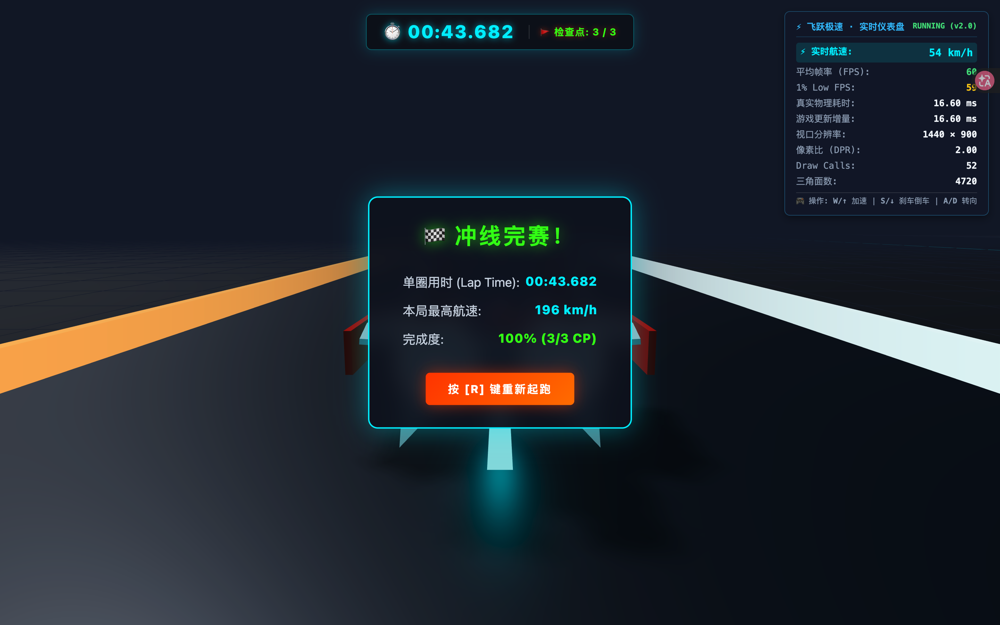

### 5. 阶段 3.1 一键重试按 R 瞬移回起跑线 (Retry Ready)
* **文件路径**：`docs/screenshots/stage3_1_retry_ready.png`
* **GitHub 直链**：[查看图片](https://raw.githubusercontent.com/liucai18/fyjs/main/docs/screenshots/stage3_1_retry_ready.png)
* **核心内容**：按 R 键干净重置赛车位置回到起跑线 (65, 0.45, -25)、朝向归零、动力清空、计时与检查点全部重置，长按 R 键具备防自动重复保护，无缝启动下一轮倒计时。

---

## 阶段 2 · 原创科幻赛车与基础驾驶系统实机运行 (Phase 2)

### 1. 阶段 2 起跑线待命实机画面 (Starting Grid)
* **文件路径**：`docs/screenshots/stage2_starting_grid.png`
* **GitHub 直链**：[查看图片](https://raw.githubusercontent.com/liucai18/fyjs/main/docs/screenshots/stage2_starting_grid.png)
* **核心内容**：第三人称智能跟随机位、起跑线门架拱门、霓虹赛道护栏与实时航速仪表盘（0 km/h）。

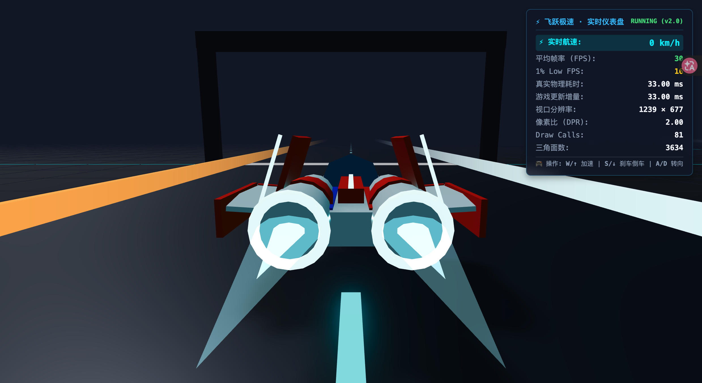

### 2. 阶段 2 极速直线冲刺实机画面 (High Speed Driving)
* **文件路径**：`docs/screenshots/stage2_high_speed_driving.png`
* **GitHub 直链**：[查看图片](https://raw.githubusercontent.com/liucai18/fyjs/main/docs/screenshots/stage2_high_speed_driving.png)
* **核心内容**：W键加速冲刺、双联重型离子矢量引擎满油门拉长超燃等离子尾焰、速度FOV景深自适应拉伸。

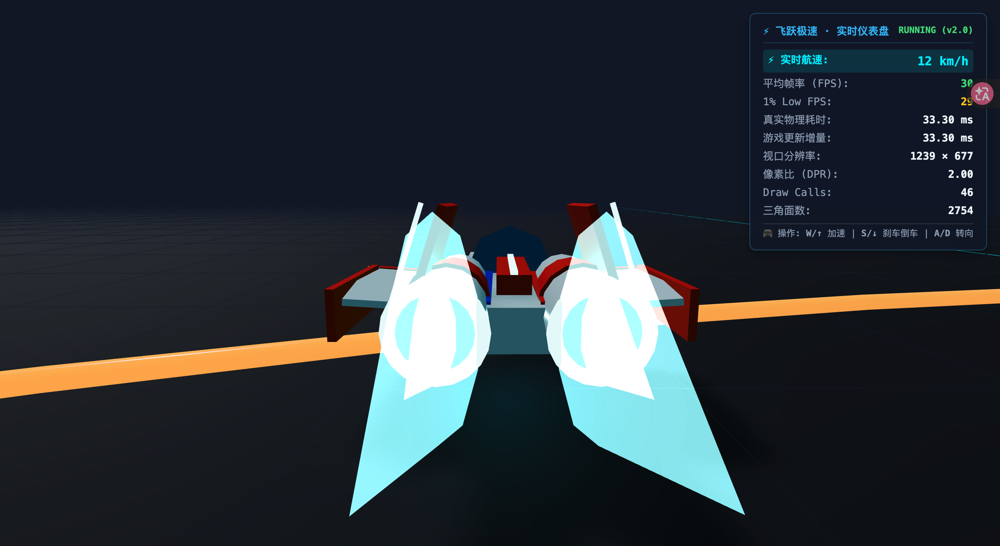

### 3. 阶段 2 北大弯 138 km/h 极限过弯实机画面 (North Curve Driving)
* **文件路径**：`docs/screenshots/stage2_north_curve_driving.png`
* **GitHub 直链**：[查看图片](https://raw.githubusercontent.com/liucai18/fyjs/main/docs/screenshots/stage2_north_curve_driving.png)
* **核心内容**：飞车以 138 km/h 侧倾顺滑通过北大弯 ($z \in [110, 185]$)，路面半圆几何与内外侧双色发光护栏、导引虚线 100% 严密对齐。

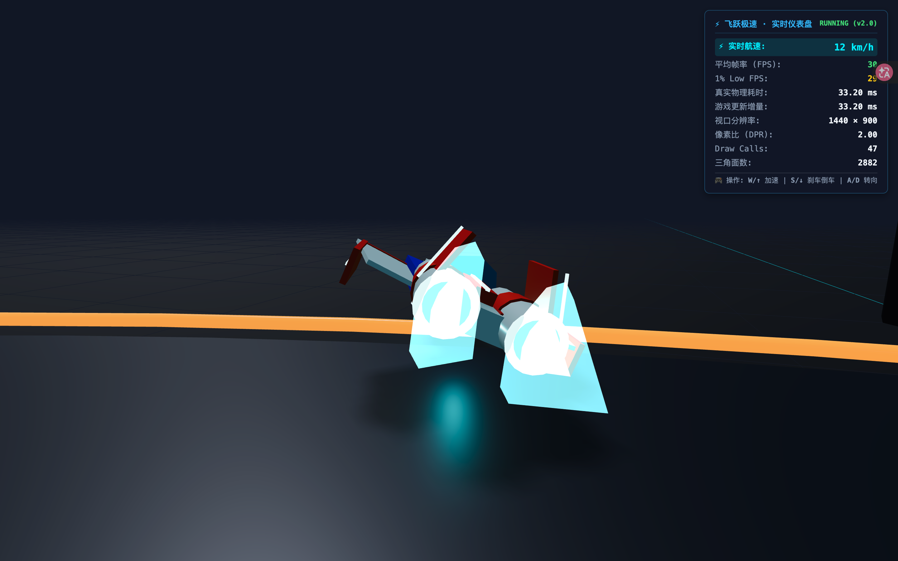

### 4. 阶段 2 南大弯 150 km/h 极限过弯实机画面 (South Curve Driving)
* **文件路径**：`docs/screenshots/stage2_south_curve_driving.png`
* **GitHub 直链**：[查看图片](https://raw.githubusercontent.com/liucai18/fyjs/main/docs/screenshots/stage2_south_curve_driving.png)
* **核心内容**：飞车以 150 km/h 侧倾顺滑通过南大弯 ($z \in [-185, -110]$)，全闭环沥青路面完全闭合无接缝，护栏边界碰撞实时法向回弹保护（瞬时速度降低 30%，动能保留约 49%）。

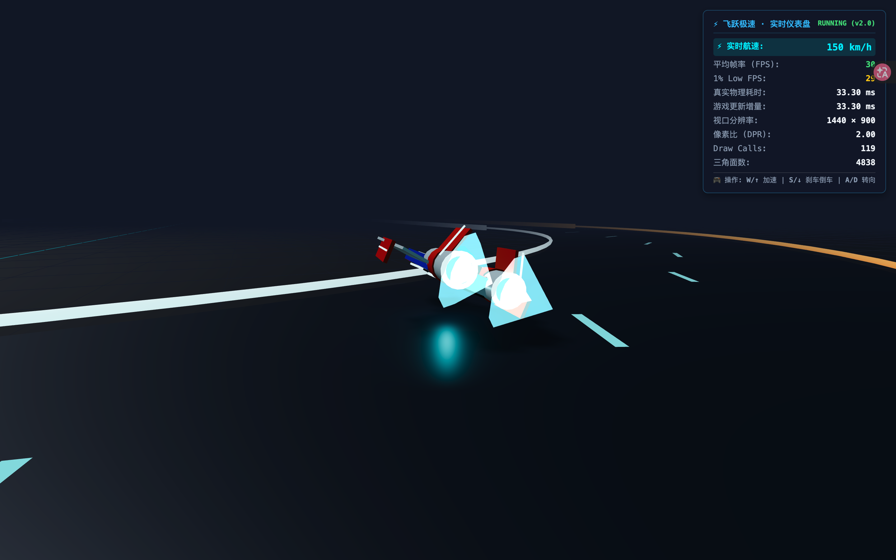

### 5. 阶段 2 赛道几何与物理规范说明
* **赛道实际总长**：$2 \times 220\text{m (直道)} + 2\pi \times 65\text{m (圆弧)} \approx 848.4\text{m}$（约 850 米大型闭环跑道）。
* **护栏弹性碰撞算法**：车辆接触护栏边界时施加法向反弹加速度，并将车辆瞬时速度乘以 0.7（即瞬时速度降低 30%，对应动能约为原始动能的 49%），彻底消除穿模与坠空隐患。

---

## 阶段 1.4 · 终极质量闭环与实机真机运行 (Phase 1.4)

### 1. 阶段 1.4 终极闭环实机运行与监控台
* **文件路径**：`docs/screenshots/stage1_4_verified.png`
* **GitHub 直链**：[查看图片](https://raw.githubusercontent.com/liucai18/fyjs/main/docs/screenshots/stage1_4_verified.png)
* **核心升级要点**：
  - **渲染器释放双重独立容错**：`renderer.dispose()` 与 `renderer.forceContextLoss()` 独立隔离包裹，杜绝驱动崩溃中断上下文销毁。
  - **HMR 真实事件切断闭环**：通过真机向 window 派发真实 `DOMContentLoaded` 事件验证监听器彻底切断，杜绝幽灵回调。
  - **构造失败二次容错**：即使清理分支自身发生异常，依然保证原始初始化错误完整向上抛出，且上下文强制销毁不遗漏。
  - **14/14 全绿自动化测试套件 + GitHub Actions CI**：全自动化质量大门守卫。

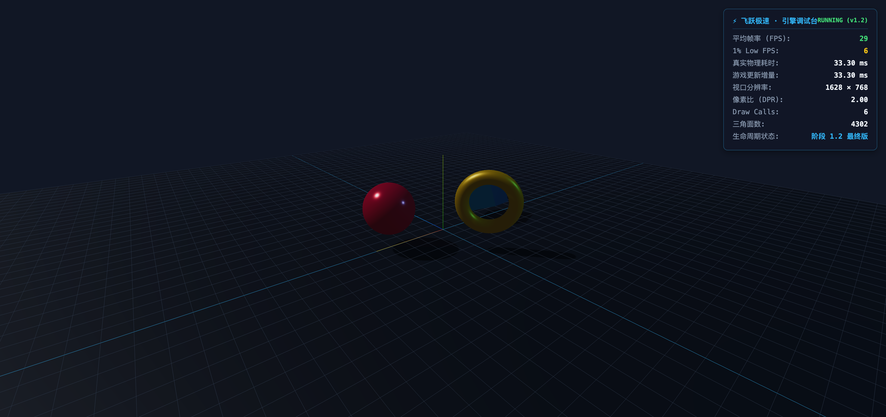

---

## 阶段 1.2 · 最终整改验收与自动化质检 (Phase 1.2)

### 1. 阶段 1.2 最终版实机运行与高精度监控台
* **文件路径**：`docs/screenshots/stage1_2_final_verification.png`
* **GitHub 直链**：[查看图片](https://raw.githubusercontent.com/liucai18/fyjs/main/docs/screenshots/stage1_2_final_verification.png)
* **核心升级要点**：
  - **1000 帧大容量滑动窗口**：高精度计算真实 1% Low FPS，样本不足 60 帧自动标定预热状态。
  - **150ms DOM 节流**：面板数据刷新采用 150ms 节流调度，彻底免除高频重绘损耗。
  - **Set 去重与幂等资源释放**：全场景几何体与材质通过 Set 集合去重释放，`dispose()` 幂等安全重复调用。
  - **9/9 自动化测试保障**：配置 Vitest 全自动化测试套件（覆盖 1% Low 统计、时间暂停恢复、重复销毁幂等性、初始化失败回滚），100% 通过。

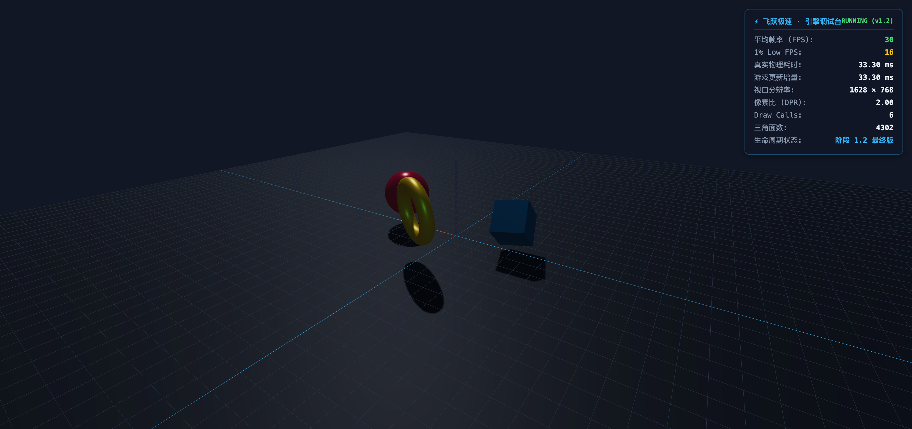

---

## 阶段 1.1 · 工程生命周期与性能监控完善 (Phase 1.1)

### 1. 阶段 1.1 实机运行与双精度性能监控台
* **文件路径**：`docs/screenshots/stage1_1_lifecycle_and_metrics.png`
* **GitHub 直链**：[查看图片](https://raw.githubusercontent.com/liucai18/fyjs/main/docs/screenshots/stage1_1_lifecycle_and_metrics.png)

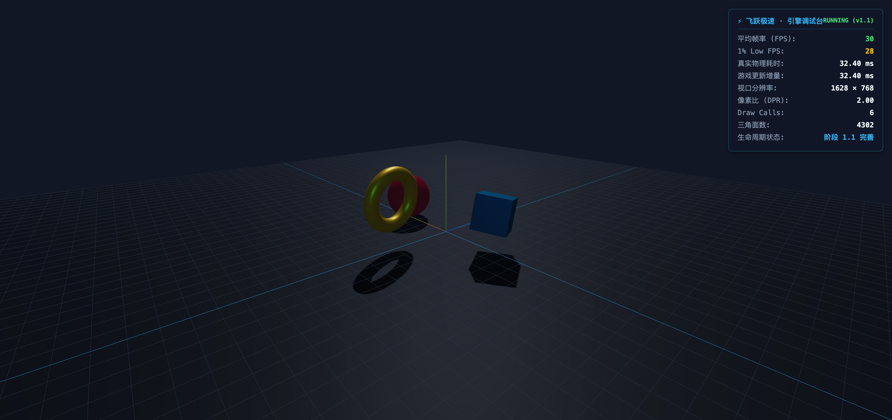

---

## 阶段 1 · 项目基础与 3D 引擎搭建 (Phase 1)

### 1. 3D 渲染引擎与调试场景初始化
* **文件路径**：`docs/screenshots/stage1_3d_engine_init.png`
* **GitHub 直链**：[查看图片](https://raw.githubusercontent.com/liucai18/fyjs/main/docs/screenshots/stage1_3d_engine_init.png)

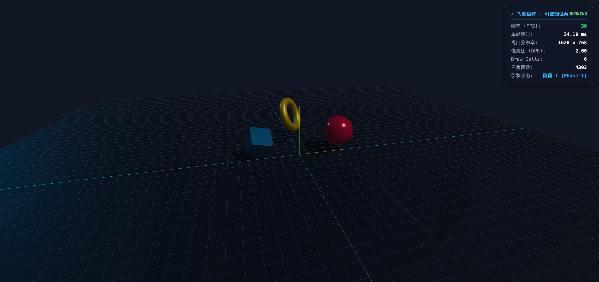
